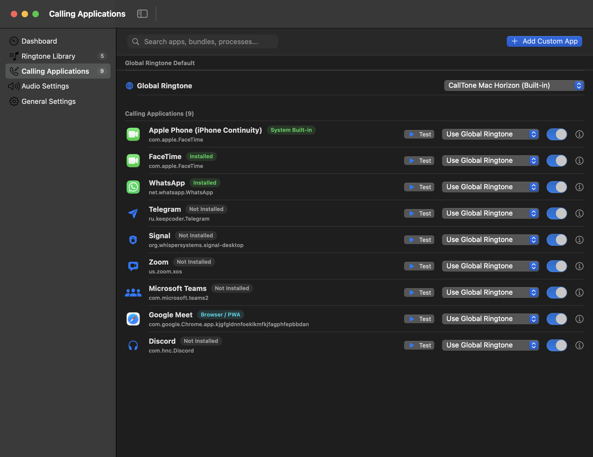
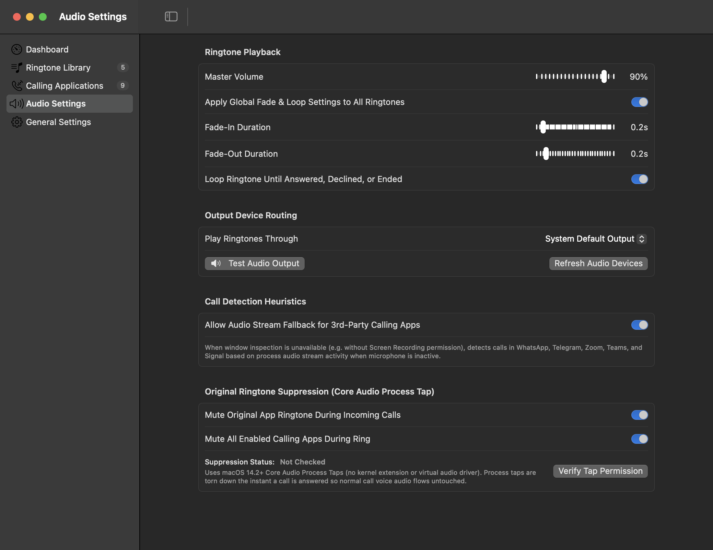

# CallTone Mac


Open-source native Swift & SwiftUI ringtone replacement utility for Apple Silicon Macs (macOS 14.2+). CallTone Mac monitors incoming calls across Apple Continuity Phone, FaceTime, and third-party calling applications, mutes the original calling app's default ringtone via Core Audio Process Taps, and plays your chosen custom tone seamlessly.

## Demo

These screenshots show CallTone Mac running in dark mode with its built-in ringtones.






## Key Features

- **Original Ringtone Suppression**: Uses macOS 14.2+ **Core Audio Process Taps** (`AudioHardwareCreateProcessTap` + `CATapDescription`) to mute the original calling app's ringtone at the Core Audio HAL layer—zero kernel extensions, virtual sound cards, or background daemons required. Taps tear down instantly on answer.
- **Universal Multi-Language Apple Call Detection**: With Accessibility permissions, CallTone Mac reads Apple's Answer and Decline controls across multiple languages (English, Spanish, French, German, Italian, Portuguese, Russian, Japanese, Chinese, Korean, Dutch, Hindi) and accessibility identifier tokens (`answerCallButton`, `rejectCallButton`).
- **Third-Party App Monitoring with Audio Fallback**: Supports WhatsApp, Telegram, Signal, Zoom, Microsoft Teams, Google Meet, and Discord with window inspection and a configurable Core Audio stream fallback.
- **Interactive Pro Waveform Trimmer**:
  - Direct draggable start and end handles on the waveform.
  - Real-time animated playhead tracking playback position.
  - Quick duration presets (First 15s, First 30s, Full Audio).
  - Precision +/- 0.1s increment/decrement nudge buttons.
  - Fade-in, fade-out, volume normalization, and continuous looping toggles.
- **Rich Offline Built-in Ringtone Suite**: Includes 5 synthesized acoustic and electronic tones generated offline with mathematical harmonic precision (CallTone Mac Horizon, Celestial Bells, Minimal Pulse, Sunny Marimba, Breeze Ambient) with one-click restore.
- **Advanced Ringtone Library**:
  - Drag-and-drop & batch import (MP3, WAV, M4A, M4R, CAF, AAC, FLAC).
  - Live animated inline playback progress bar and time counters in each library row.
  - One-click "Assign to Calling App" context menu.
  - Ringtone duplication, M4A export, and Finder reveal.
- **Calling Applications Hub**:
  - Real-time search by app name, bundle ID, or process name.
  - Direct "Test" button on every app row to simulate that app's ringtone immediately.
  - App Profile Inspector displaying registered bundle IDs, Core Audio process names, and window keywords.
  - Custom app importer for any macOS `.app` bundle.
- **Audio Output Routing & Testing**:
  - Independent output device selection (AirPods, external speakers, display audio, system default).
  - "Test Audio Output" chime button to verify sound routing without waiting for an incoming call.
- **Background Menu Bar Integration**:
  - Runs in the background with minimal idle CPU and memory.
  - Menu bar icon alerts when incoming calls arrive.
  - Quick-switch ringtone picker, pause/resume monitoring, and stop ringing controls.
## Privacy

Call detection, audio processing, and ringtone storage stay on your Mac. CallTone Mac does not share or send your personal or call data.

See the [privacy policy](PRIVACY.md) for details. CallTone Mac uses macOS Accessibility to detect Apple’s call controls and macOS audio capture permission to mute original ringtones. It does not save call audio. Update checks make an HTTPS request to GitHub for public release metadata and do not include call or ringtone data. GitHub can see ordinary connection metadata such as your IP address.

## Install

Download the notarized `CallTone-Mac-1.0.0.zip` from [GitHub Releases](https://github.com/Mahesh-Vanga/CallTone-Mac/releases). Unzip it, move CallTone Mac to Applications, and open it. macOS may ask you to confirm the first launch. If upgrading from the earlier CallTone build, quit it and remove the old app bundle so macOS only has one copy. Your settings and ringtone library are stored separately.

## Build & Package

On macOS, install the build-time DMG layout tool in a virtual environment, then run the packaging script.

```bash
python3 -m venv .build/dmg-tools
.build/dmg-tools/bin/pip install dmgbuild==1.6.5
DMGBUILD="$PWD/.build/dmg-tools/bin/dmgbuild" ./scripts/build_and_package.sh
```

This compiles for Apple Silicon (`arm64`), generates native multi-resolution icons (`.icns`), signs the app, and outputs:
- `dist/CallTone Mac.app`
- `dist/CallTone-Mac-1.0.0.dmg`
- `dist/CallTone-Mac-1.0.0.pkg`

### Signing & Notarization (Optional)

For a public release, use the Developer ID Application and Installer identities from Keychain and a notarization profile created with `xcrun notarytool store-credentials`. The script signs the app and DMG with the Application identity, signs the PKG with the Installer identity, and submits and staples both installers:

```bash
SIGNING_IDENTITY="Developer ID Application: …" \
INSTALLER_IDENTITY="Developer ID Installer: …" \
NOTARY_PROFILE="YourNotaryProfile" \
DMGBUILD="$PWD/.build/dmg-tools/bin/dmgbuild" ./scripts/build_and_package.sh
```

## Uninstall

```bash
./scripts/uninstall.sh
```

Removes `/Applications/CallTone Mac.app` while preserving custom ringtones in `~/Library/Application Support/CallTone/Ringtones`.

## First launch and updates

The welcome screen appears on first launch and after an app update. It explains call detection, the MIT license, privacy, and the macOS permissions for Accessibility, System Audio Recording, and optional notifications. Monitoring starts after you choose **Agree and Continue**, according to your existing monitoring preference. You can grant or change permissions later in macOS System Settings.

## Change your ringtone

Open **Ringtone Library**, choose a built-in tone or select **Import Audio**, then choose **Set as Global Ringtone** or **Assign to Calling App**. Ringtone changes take effect locally and require no download from GitHub.

## Update notifications

Open **Settings → Updates → Check for Updates** to refresh the public GitHub release feed in one click. Enable **Check for Updates Automatically** to check when CallTone Mac opens or becomes active. Automatic checks are off by default and run at most once a day while the app stays open. A newer stable release opens an in-app alert with a link to GitHub.

The release repository is configured by `CallToneUpdateRepository` in `Resources/Info.plist`. For each update, increase `CFBundleShortVersionString` and publish a matching stable tag such as `v1.0.1` with the notarized download. GitHub also generates source archives for tagged releases.

Run `swift test` on macOS to verify the package.
