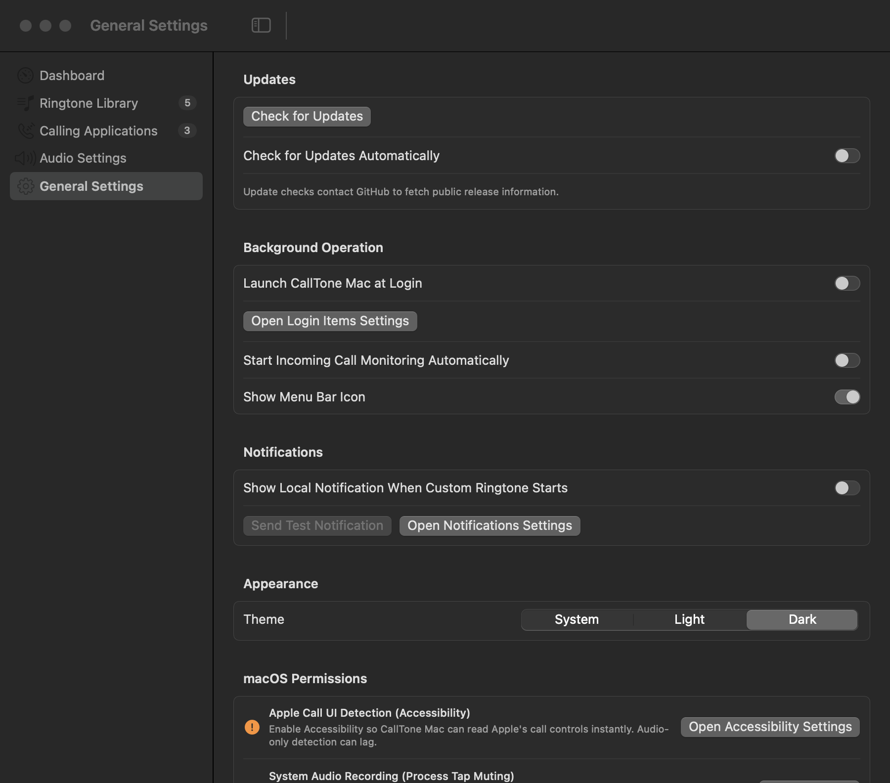
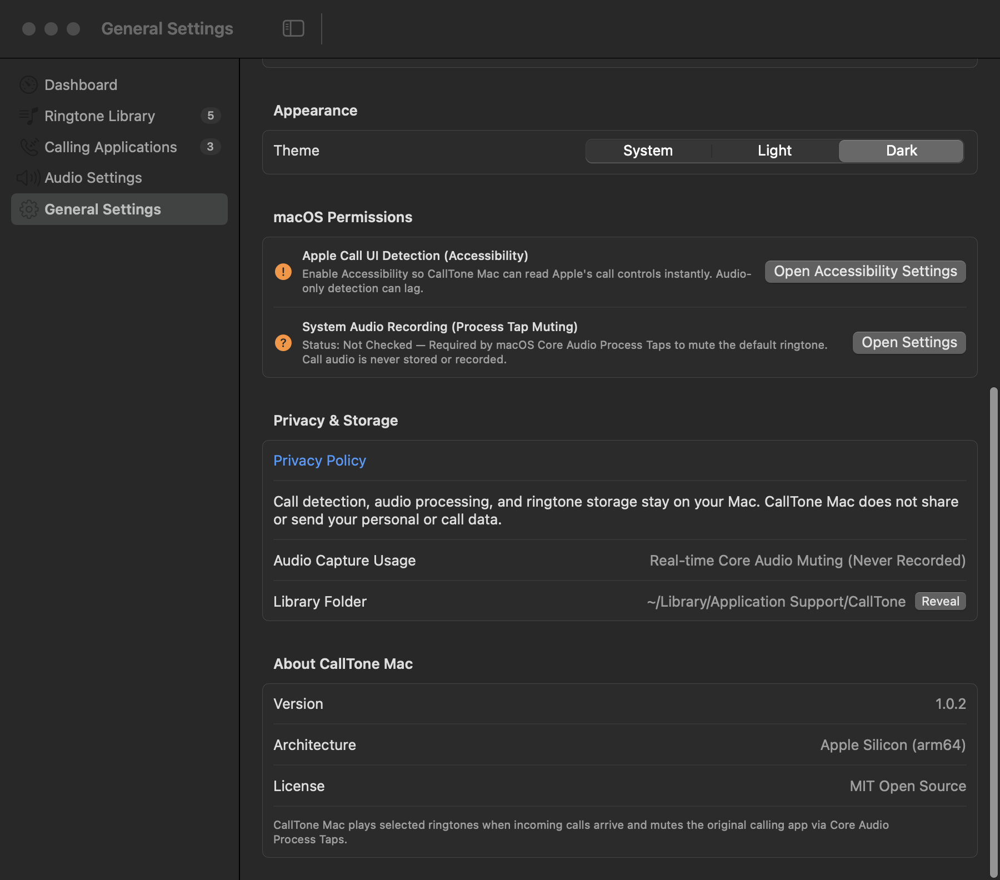

# CallTone Mac


Set custom ringtones for incoming calls on your Mac. Choose one global tone or assign a different tone to FaceTime, WhatsApp, and other calling apps. CallTone Mac is a native Swift and SwiftUI app that processes call signals and audio on your Mac.

**Apple Silicon · macOS 14.2 or later · MIT license**

[Download CallTone Mac 1.0.0 (DMG)](https://github.com/Mahesh-Vanga/CallTone-Mac/releases/download/v1.0.0/CallTone-Mac-1.0.0.dmg) · [All releases](https://github.com/Mahesh-Vanga/CallTone-Mac/releases) · [Report an issue](https://github.com/Mahesh-Vanga/CallTone-Mac/issues)

[Install](#install) · [First launch and permissions](#first-launch-and-permissions) · [App walkthrough](#app-walkthrough) · [Troubleshooting](#troubleshooting) · [Build from source](#build-from-source)

## Install

Choose one of the three Apple-notarized downloads for Apple Silicon Macs.

| Download | How to install |
| --- | --- |
| [DMG](https://github.com/Mahesh-Vanga/CallTone-Mac/releases/download/v1.0.0/CallTone-Mac-1.0.0.dmg) | Open the disk image and drag **CallTone Mac** to **Applications**. |
| [PKG](https://github.com/Mahesh-Vanga/CallTone-Mac/releases/download/v1.0.0/CallTone-Mac-1.0.0.pkg) | Open the package and follow the macOS Installer prompts. |
| [ZIP](https://github.com/Mahesh-Vanga/CallTone-Mac/releases/download/v1.0.0/CallTone-Mac-1.0.0.zip) | Double-click the ZIP and move **CallTone Mac.app** to **Applications**. |

Open CallTone Mac from **Applications** and follow the welcome screen. macOS may ask you to confirm the first launch. GitHub also lists source archives for developers.

### Download and verify in Terminal

Run this on an Apple Silicon Mac. It downloads and extracts the release in a temporary folder, checks its signature and notarization ticket, and opens the folder so you can move the app to Applications. The `xcrun stapler` check requires Xcode or its command-line tools.

```bash
download_dir="$(mktemp -d)"
(
  set -e
  cd "$download_dir"
  curl --fail --location --remote-name \
    https://github.com/Mahesh-Vanga/CallTone-Mac/releases/download/v1.0.0/CallTone-Mac-1.0.0.zip
  ditto -x -k CallTone-Mac-1.0.0.zip .
  codesign --verify --deep --strict "CallTone Mac.app"
  xcrun stapler validate "CallTone Mac.app"
  spctl --assess --type execute --verbose=2 "CallTone Mac.app"
  open .
)
```

A successful Gatekeeper assessment reports `accepted` and `source=Notarized Developer ID`.

## First launch and permissions

Read the welcome screen and select **Agree and Continue**. To change permissions later, use **General Settings → macOS Permissions** or **System Settings**. To start manually, open the **Dashboard** and select **Start Monitoring**.

| Permission | What CallTone Mac uses it for |
| --- | --- |
| Accessibility | Detects Apple's Answer and Decline controls for faster iPhone Continuity and FaceTime call detection. Without it, audio-based detection may respond later. |
| System Audio Recording | Lets Core Audio Process Taps mute the original ringtone while the replacement plays. The taps do not save recordings. |
| Notifications (optional) | Shows a local notification when a custom ringtone starts if you enable it in General Settings. |
| Screen Recording, where needed | Some third-party detection paths depend on visibility into the calling app's windows. **Allow Audio Stream Fallback for 3rd-Party Calling Apps** in Audio Settings can help when window information is unavailable. |

## App walkthrough

The screenshots show the real app in dark mode with its built-in tones and a sample audio setup.

### Dashboard

Start or pause monitoring, see the active call and recent detection activity, check permissions and audio status, and preview or change the global ringtone. Choose a calling app and select **Simulate Call** to test ringtone playback without placing a real call.


### Ringtone Library

Select **Import Audio** or drag files into the library. Supported imports include MP3, WAV, M4A, M4R, CAF, AAC, AIFF, and FLAC. Play a tone to preview it, then select **Set Global** or use **Assign to Calling App** in its menu. **Built-in Tones** restores the five included tones. The row menu also offers duplicate, rename, M4A clip export, and **Reveal in Finder**.


### Waveform Trimmer

Select **Trim & Edit** beside a tone. Drag the waveform handles or adjust **Start Time** and **End Time** with the sliders and step buttons. The presets select the first 15 seconds, first 30 seconds, or full audio. Adjust fade-in, fade-out, clip volume, and looping, then select **Preview Trimmed Clip** and **Save Changes**.


### Calling Applications

The built-in profiles include Apple Phone (iPhone Continuity), FaceTime, WhatsApp, Telegram, Signal, Zoom, Microsoft Teams, Google Meet, and Discord. Search by app name, bundle identifier, or process name. Each row lets you enable monitoring, select a tone or **Use Global Ringtone**, run a **Test**, and inspect the app profile. **Add Custom App** adds a local macOS app bundle. Detection depends on the calling app's window and audio behavior.


### Audio Settings

Set master volume, global fade and loop overrides, and the output device. Use **Test Audio Output** to confirm the selected route or **Refresh Audio Devices** after connecting hardware. This page also controls third-party audio fallback, original ringtone suppression, and the scope of muting. Use **Verify Tap Permission** to check whether suppression is available.


### General Settings

Configure update checks, launch at login, automatic monitoring, the menu bar icon, notifications, and the System, Light, or Dark appearance. The same page provides macOS permission controls, a link to the privacy policy, access to the local library folder, and app version and license information.





### Menu bar and keyboard shortcuts

Use the menu bar icon to reopen the window, pause or resume monitoring, switch the global tone, stop a ringtone or preview, or quit CallTone Mac.

| Shortcut | Action |
| --- | --- |
| ⌘1 / ⌘2 / ⌘3 / ⌘4 / ⌘5 | Open Dashboard / Ringtone Library / Calling Applications / Audio Settings / General Settings |
| ⇧⌘M | Toggle monitoring |
| ⌘. | Stop the current ringtone or preview |

## Update or uninstall

- **Check for updates** in **General Settings → Updates**. Automatic checks are optional and off by default. A newer stable release opens an alert with a GitHub link.
- **Upgrade** by quitting the running app and replacing the copy in Applications with the new release. Keep one installed copy. Your settings and library are stored separately.
- **Uninstall** by quitting CallTone Mac from its menu bar menu and moving the app from Applications to Trash. If you have the source checkout, you can also run `./scripts/uninstall.sh` from the repository root. Both methods preserve the library.
- **Back up your library and settings** by copying `~/Library/Application Support/CallTone/`. The imported audio files are in its `Ringtones/` folder.

## Troubleshooting

| Symptom | What to check |
| --- | --- |
| macOS flags the download | Confirm you downloaded an installer from the release assets. Use the ZIP verification commands above or the DMG and PKG checks below. A normal first-open confirmation can still appear. |
| The custom ringtone is silent | Preview it in **Ringtone Library**, then run **Test Audio Output**. Check master volume, output routing, the calling app's assigned tone, and whether monitoring is active. |
| Both ringtones play | In **Audio Settings**, enable **Mute Original App Ringtone During Incoming Calls** and run **Verify Tap Permission**. Check System Audio Recording access in macOS settings. |
| An Apple call rings late or is missed | Check Accessibility access, confirm the Apple Phone or FaceTime profile is enabled, and review the Dashboard's recent activity. |
| A third-party call is missed | Enable the corresponding app profile, verify its tone with **Test**, and check the audio fallback setting. A successful test confirms playback. Use a real call to check detection. |
| Permissions changed after an upgrade | Confirm you opened the copy in Applications and review its permissions in **General Settings → macOS Permissions**. |

## How it works

CallTone Mac uses Apple Accessibility controls and calling-app window and audio signals to detect ringing. It resolves the per-app tone or global default, then plays that tone through the selected audio output. When suppression is enabled and permitted, it uses Core Audio Process Taps to mute the original ringtone during ringing and releases the taps when the call is answered or ends. It uses macOS frameworks without a kernel extension or a virtual audio driver.

Call processing, settings, and ringtone storage stay on the Mac. CallTone Mac has no account, ads, or analytics. Manual and optional automatic update checks fetch public GitHub release metadata over HTTPS. [Privacy policy](PRIVACY.md)

## Build from source

Use an Apple Silicon Mac with Xcode or its command-line tools, a Swift 6 toolchain with a macOS SDK, and Python 3 for the DMG packaging tool.

```bash
git clone https://github.com/Mahesh-Vanga/CallTone-Mac.git
cd CallTone-Mac
swift test

python3 -m venv .build/dmg-tools
.build/dmg-tools/bin/python -m pip install dmgbuild==1.6.5
DMGBUILD="$PWD/.build/dmg-tools/bin/dmgbuild" ./scripts/build_and_package.sh
```

The script builds an arm64 release and writes the app bundle and versioned DMG and PKG to `dist/`. The default build uses ad-hoc signing for the app and creates an unsigned PKG. Use Developer ID signing and Apple notarization for public distribution.

### Sign and notarize installers

Install your **Developer ID Application** and **Developer ID Installer** identities in Keychain. Create a named Apple notarization profile and enter the requested credentials privately when prompted.

```bash
xcrun notarytool store-credentials CallToneNotary
```

Set the two identity values to your Keychain certificate names, then build, sign, submit, and staple the DMG and PKG.

```bash
SIGNING_IDENTITY="Developer ID Application: Your Name (TEAMID)" \
INSTALLER_IDENTITY="Developer ID Installer: Your Name (TEAMID)" \
NOTARY_PROFILE="CallToneNotary" \
DMGBUILD="$PWD/.build/dmg-tools/bin/dmgbuild" ./scripts/build_and_package.sh
```

Check submission status and verify both distributable files. Replace the version in the paths when building a newer release.

```bash
xcrun notarytool history --keychain-profile CallToneNotary
xcrun stapler validate dist/CallTone-Mac-1.0.0.dmg
xcrun stapler validate dist/CallTone-Mac-1.0.0.pkg
spctl --assess --type open --context context:primary-signature --verbose=2 dist/CallTone-Mac-1.0.0.dmg
spctl --assess --type install --verbose=2 dist/CallTone-Mac-1.0.0.pkg
```

When publishing a new version, update the version fields in [Info.plist](Resources/Info.plist) and publish a matching stable GitHub tag, such as `v1.0.1`, with the verified download. The app reads its update repository from `CallToneUpdateRepository` in that plist.

## Project layout and contributions

| Path | Contents |
| --- | --- |
| [Sources/CallTone/Engine](Sources/CallTone/Engine) | Call detection, Core Audio suppression, playback, and output routing |
| [Sources/CallTone/Managers](Sources/CallTone/Managers) | Ringtone library, app settings, and menu bar |
| [Sources/CallTone/Views](Sources/CallTone/Views) | SwiftUI screens and the waveform trimmer |
| [Tests/CallToneTests](Tests/CallToneTests) | Automated tests for detection, settings, the library, and updates |
| [scripts](scripts) | Packaging and uninstall scripts |

For a bug report, include your macOS version, CallTone version, calling app, steps to reproduce, and what you expected. Crop screenshots to the app and remove caller information. For code changes, run `swift test` before opening a pull request. [GitHub Issues](https://github.com/Mahesh-Vanga/CallTone-Mac/issues)

CallTone Mac is available under the [MIT License](LICENSE).
