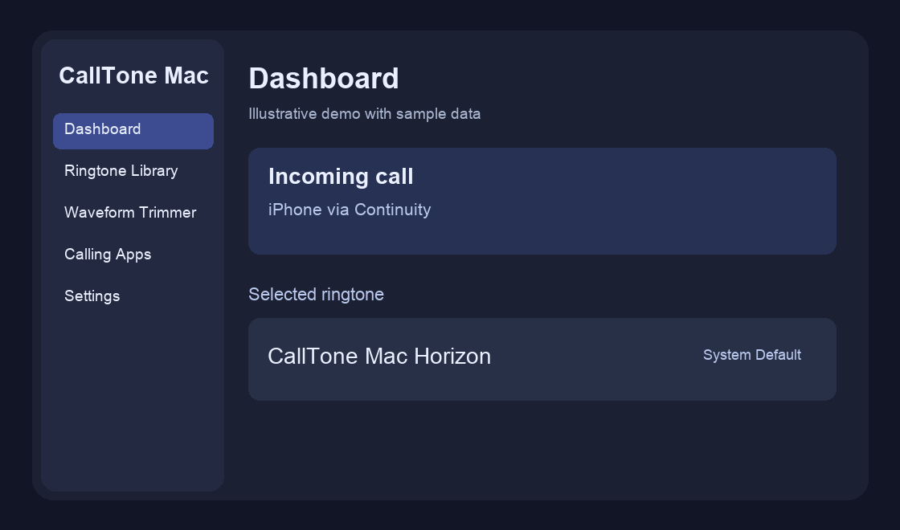
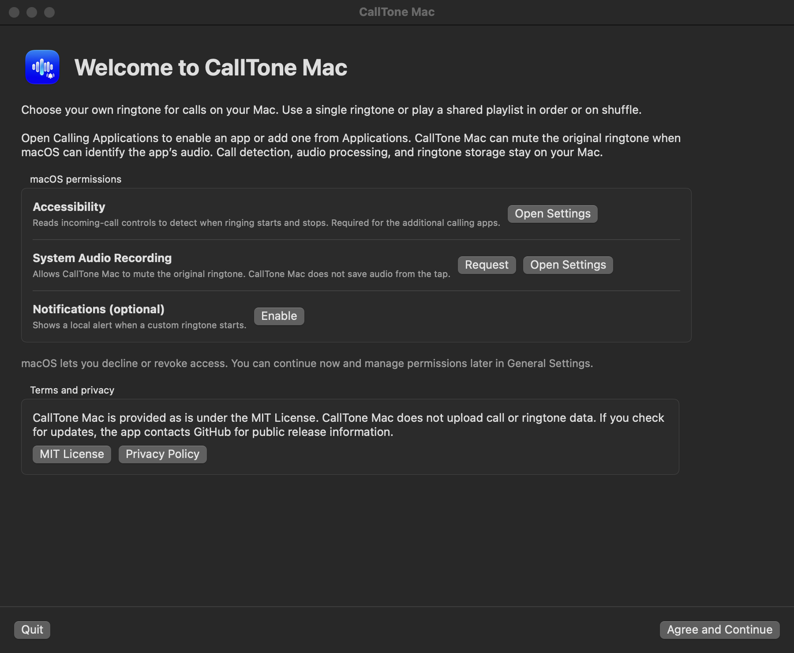
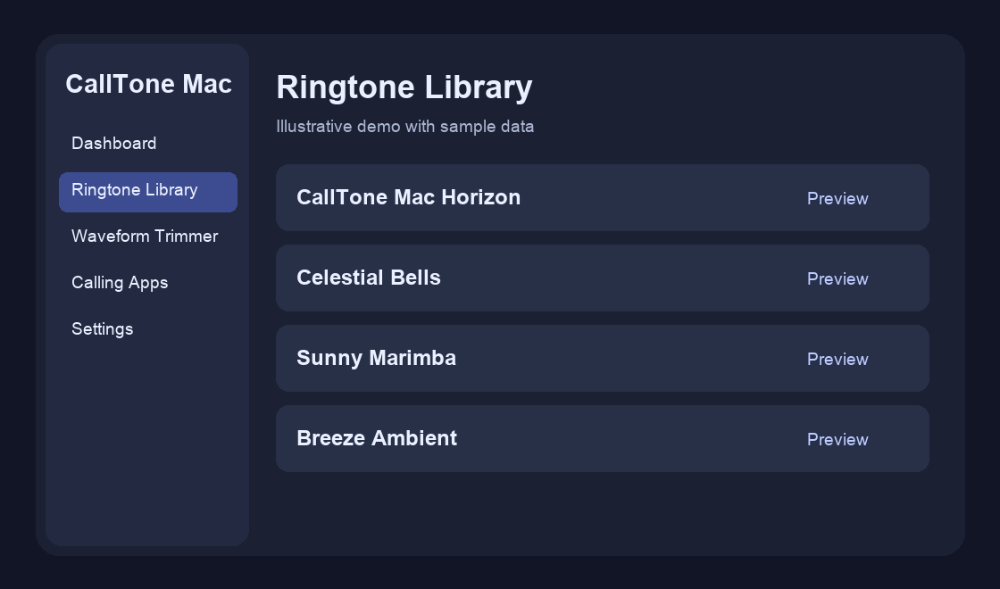
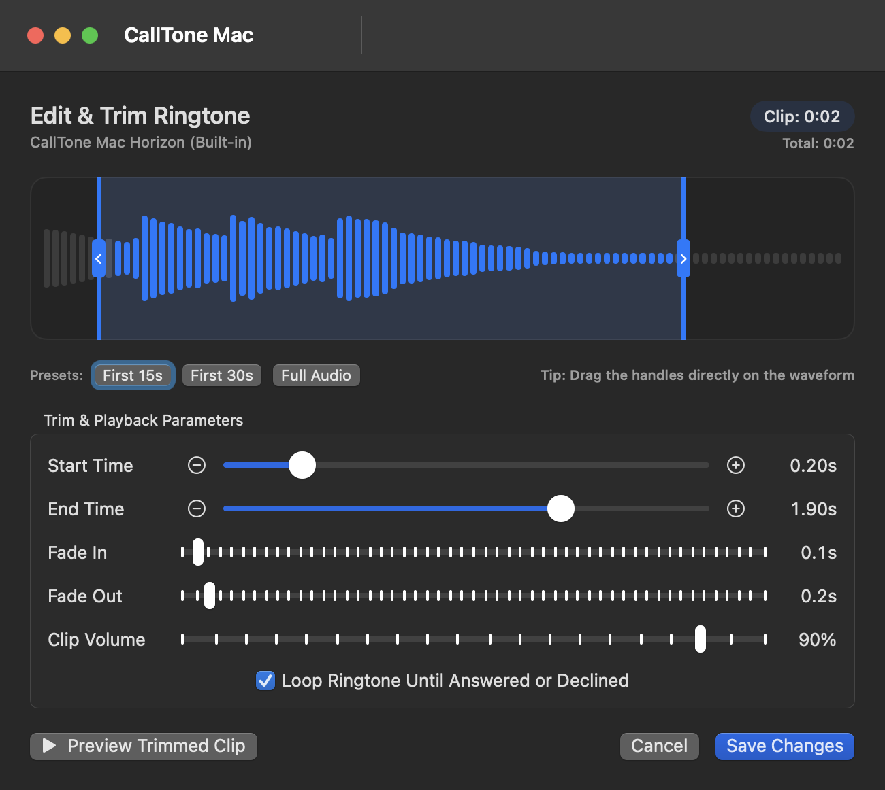

# CallTone Mac


**Your music for incoming calls on macOS.** Replace a calling app’s ringtone with a single tone or a shared playlist. CallTone runs in the menu bar and processes calls and audio locally.

**Version 1.0.2 · Apple Silicon · macOS 14.2 or later · [MIT License](LICENSE)**

[Download DMG](https://github.com/Mahesh-Vanga/CallTone-Mac/releases/download/v1.0.2/CallTone-Mac-1.0.2.dmg) · [Download PKG](https://github.com/Mahesh-Vanga/CallTone-Mac/releases/download/v1.0.2/CallTone-Mac-1.0.2.pkg) · [Download ZIP](https://github.com/Mahesh-Vanga/CallTone-Mac/releases/download/v1.0.2/CallTone-Mac-1.0.2.zip) · [What’s new in 1.0.2](https://github.com/Mahesh-Vanga/CallTone-Mac/releases/tag/v1.0.2)

[Install](#install) · [Features](#features) · [Screens](#screens) · [Terminal](#terminal) · [Troubleshooting](#troubleshooting) · [License](#license)



## What’s new in 1.0.2

- **Quiet startup.** CallTone starts in the menu bar with its window closed, including when launched at login. Open it again from Applications or choose **Open CallTone Mac** from the menu bar to show the window.
- **Login and notification controls.** **General Settings** shows when the login item needs approval. It also includes a test notification and links to the relevant macOS settings.
- **Setup across updates.** CallTone remembers your welcome agreement and initial audio permission request. macOS manages the actual grants.
- **Menu bar operation.** CallTone stays out of the Dock and the Force Quit Applications list. The menu bar contains **Open CallTone Mac** and **Quit CallTone Mac**.

## Install

| Download | Installation |
| --- | --- |
| [DMG](https://github.com/Mahesh-Vanga/CallTone-Mac/releases/download/v1.0.2/CallTone-Mac-1.0.2.dmg) | Open the disk image and drag **CallTone Mac** into **Applications**. |
| [PKG](https://github.com/Mahesh-Vanga/CallTone-Mac/releases/download/v1.0.2/CallTone-Mac-1.0.2.pkg) | Open the package and follow the macOS Installer prompts. |
| [ZIP](https://github.com/Mahesh-Vanga/CallTone-Mac/releases/download/v1.0.2/CallTone-Mac-1.0.2.zip) | Extract the archive and move **CallTone Mac.app** into **Applications**. |

All three v1.0.2 downloads pass Gatekeeper as **Notarized Developer ID**. macOS can show its standard first-open confirmation for apps downloaded from the internet. Select **Open** when the dialog identifies CallTone Mac as the app you downloaded. The PKG may request administrator authorization, and optional app permissions have their own prompts. [Apple’s Gatekeeper guide](https://support.apple.com/en-us/102445)

### First launch

1. Open CallTone Mac from **Applications**.
2. Click the menu bar icon and choose **Open CallTone Mac**. You can also open the app again from Applications.
3. Review the welcome screen and choose **Agree and Continue**.
4. Enable your calling apps under **Calling Applications** and pick a ringtone mode in **Ringtone Library**. If monitoring is paused, choose **Start Monitoring** on the Dashboard.

| macOS permission | Purpose |
| --- | --- |
| Accessibility | Reads incoming-call controls. It supports iPhone Continuity and FaceTime detection and is required for the Accessibility-based calling app profiles. |
| System Audio Recording | Lets Core Audio temporarily mute the identified native ringtone. Audio from the tap is discarded. |
| Notifications | Optional local banners when a custom ringtone starts. Use **Send Test Notification** in **General Settings** to check. |
| Screen Recording | macOS may restrict window information used by some detection paths. Review access in **System Settings → Privacy & Security → Screen & System Audio Recording** if needed. |

## Features

| Feature | What you can do |
| --- | --- |
| **Single, Sequential, and Shuffle** | Choose a default tone or per-app tones in Single mode. Sequential follows the order you set. Shuffle plays each selected tone once per cycle and avoids immediate repeats when several tones are selected. Playlist modes share one queue across calling apps and prepare the next track after ringing stops. **Simulate Call** advances that queue too. |
| **Calling app profiles** | Enable iPhone Continuity, FaceTime, WhatsApp, Telegram, Signal, Zoom, Microsoft Teams, Google Meet, and Discord individually. Use **Add Custom App** to select one or more installed macOS apps. |
| **Native ringtone muting** | CallTone attempts to mute audio attributable to the ringing app while your tone plays. Custom apps need recognizable incoming-call controls. For Google Meet, keep the Meet tab or web app open. Its original ring can still be heard when Meet shares the browser’s audio process. |
| **Ringtone library** | Use five built-in tones or import MP3, WAV, M4A, M4R, CAF, AAC, AIFF, and FLAC. Preview, rename, duplicate, delete, reveal files in Finder, and export trimmed M4A clips. |
| **Waveform editing** | Trim a clip, set volume, set fade-in and fade-out, toggle looping, and preview before saving. |
| **Status and testing** | Check monitoring and permission status, view recent detection activity, simulate a call, test a calling app’s tone, or send a test notification. |
| **Audio and appearance** | Set master volume and the output device. Choose System, Light, or Dark appearance. |
| **Background controls** | Start at login, monitor automatically, pause or resume from the menu bar, and check for updates manually or automatically. |

## Screens

The screenshots use the built-in tones and sample settings.

### Welcome and permissions

Set up Accessibility and System Audio Recording, enable optional notifications, and read the MIT License and Privacy Policy.



### Dashboard

See whether monitoring is active, which tone or playlist is selected, and what CallTone detected. Use **Simulate Call** to try playback without placing a real call.

[View the Dashboard screenshot](docs/demo/dashboard.png)

### Ringtone Library

Import or drag in audio. Choose **Single**, **Sequential**, or **Shuffle**. In playlist modes, check the tracks to include and use **Move Earlier in Sequence** or **Move Later in Sequence** to change their order. An empty playlist falls back to the single-tone selection.



### Waveform Trimmer

Choose **Trim & Edit**. Drag the waveform handles or enter exact start and end positions. Select a 15-second, 30-second, or full-audio preset, adjust fades and volume, then preview and save.



### Calling Applications

Search by app name, bundle identifier, or process name. Enable profiles, run **Test** to check playback, inspect detection details, and use the app picker to add installed apps. You can remove custom profiles from this screen. Assign app-specific tones in Single mode.


### Audio Settings

Choose an output device, test playback, and adjust master volume, fades, and looping. Use **Refresh Audio Devices** after connecting hardware. The audio stream fallback can help detect WhatsApp, Telegram, Zoom, Teams, and Signal calls when window inspection is unavailable and the microphone is inactive. **Mute All Enabled Calling Apps During Ring** extends suppression to enabled apps. Open System Audio Recording settings here to manage access.


### General Settings

Manage launch at login, automatic monitoring, the menu bar icon, notifications, and appearance. Check for updates, open macOS permission settings, reveal the library folder, or view the installed version and license.


<details>
<summary>Privacy, storage, and About</summary>


</details>

### Menu bar and shortcuts

Use the menu bar to open CallTone, pause or resume monitoring, switch the shared tone, stop playback, or quit.

| Shortcut | Action |
| --- | --- |
| ⌘1 through ⌘5 | Dashboard, Ringtone Library, Calling Applications, Audio Settings, General Settings |
| ⌘I | Import audio in Ringtone Library |
| ⇧⌘M | Toggle monitoring |
| ⌘. | Stop the current ringtone or preview |

## Terminal

For a first install on an Apple Silicon Mac, choose one format. For an update, quit CallTone from the menu bar and use the replacement instructions in [Update or uninstall](#update-or-uninstall).

<details>
<summary>DMG · Download, verify, and copy to Applications</summary>

```bash
(
  set -e
  work="$(mktemp -d)"
  cd "$work"
  curl --fail --location --remote-name \
    https://github.com/Mahesh-Vanga/CallTone-Mac/releases/download/v1.0.2/CallTone-Mac-1.0.2.dmg
  spctl --assess --type open --context context:primary-signature --verbose=2 CallTone-Mac-1.0.2.dmg
  mkdir mount
  hdiutil attach -readonly -nobrowse -mountpoint "$work/mount" CallTone-Mac-1.0.2.dmg
  trap 'hdiutil detach "$work/mount" >/dev/null' EXIT
  test ! -e "/Applications/CallTone Mac.app"
  ditto "$work/mount/CallTone Mac.app" "/Applications/CallTone Mac.app"
  open "/Applications/CallTone Mac.app"
)
```

</details>

<details>
<summary>PKG · Download, verify, and install</summary>

```bash
(
  set -e
  work="$(mktemp -d)"
  cd "$work"
  curl --fail --location --remote-name \
    https://github.com/Mahesh-Vanga/CallTone-Mac/releases/download/v1.0.2/CallTone-Mac-1.0.2.pkg
  pkgutil --check-signature CallTone-Mac-1.0.2.pkg
  spctl --assess --type install --verbose=2 CallTone-Mac-1.0.2.pkg
  sudo installer -pkg CallTone-Mac-1.0.2.pkg -target /
  open "/Applications/CallTone Mac.app"
)
```

</details>

<details>
<summary>ZIP · Download, verify, and copy to Applications</summary>

```bash
(
  set -e
  work="$(mktemp -d)"
  cd "$work"
  curl --fail --location --remote-name \
    https://github.com/Mahesh-Vanga/CallTone-Mac/releases/download/v1.0.2/CallTone-Mac-1.0.2.zip
  ditto -x -k CallTone-Mac-1.0.2.zip .
  codesign --verify --deep --strict "CallTone Mac.app"
  spctl --assess --type execute --verbose=2 "CallTone Mac.app"
  test ! -e "/Applications/CallTone Mac.app"
  ditto "CallTone Mac.app" "/Applications/CallTone Mac.app"
  open "/Applications/CallTone Mac.app"
)
```

</details>

A successful Gatekeeper check reports `accepted` and `source=Notarized Developer ID`. The DMG and ZIP commands expect an empty destination. If your account cannot write to **Applications**, complete the copy in Finder. To reopen the installed app from Terminal, run `open "/Applications/CallTone Mac.app"`. After startup, run it again to show the app window.

## Update or uninstall

- **Check for updates** from **General Settings → Updates**. When a newer stable release is available, CallTone opens its GitHub release page on request.
- **Update** by choosing **Quit CallTone Mac** in the menu bar, then replacing the app in **Applications** with the newest version. Your library and settings are stored separately.
- **Uninstall** by disabling Launch at Login in General Settings, quitting from the menu bar, and moving **CallTone Mac.app** to Trash. You can also run `./scripts/uninstall.sh` from a source checkout.
- **Back up** your library and settings by copying `~/Library/Application Support/CallTone/`. Imported audio lives in its `Ringtones/` folder.

## Troubleshooting

| Symptom | What to check |
| --- | --- |
| Opening the app shows no window | Look for the CallTone icon in the menu bar. Choose **Open CallTone Mac** or open the app again from Applications. |
| macOS reports an unidentified developer or failed verification | Download a fresh copy from the official release and verify it using the Terminal steps. A first-open confirmation from macOS is normal. |
| The app does not start at login | Enable **Launch CallTone Mac at Login** in **General Settings**. Use **Open Login Items Settings** if macOS needs approval. |
| No notification banner appears | Enable notifications in **General Settings** and check CallTone’s alert style in macOS Notifications settings. Select **Send Test Notification** to verify. |
| No custom audio plays | Preview a tone in the library, check monitoring and the app profile, and run **Test Audio Output** to verify volume and routing. |
| The native and custom ringtones both play | Check System Audio Recording in macOS Settings. Google Meet can share an audio process with the rest of the browser. |
| A call is missed | Confirm the profile is enabled and Accessibility is granted. **Test** verifies playback. Place a real call to check detection. |

## Privacy

Call detection, audio processing, and ringtone storage stay on the Mac. CallTone uses macOS Accessibility and Core Audio and does not save captured audio. Optional update checks request public release information from GitHub. See the [Privacy Policy](PRIVACY.md).

## Build from source

Use an Apple Silicon Mac with Xcode or the command-line tools, Swift 6, and Python 3.

```bash
git clone https://github.com/Mahesh-Vanga/CallTone-Mac.git
cd CallTone-Mac
swift test

python3 -m venv .build/dmg-tools
.build/dmg-tools/bin/python -m pip install dmgbuild==1.6.5
DMGBUILD="$PWD/.build/dmg-tools/bin/dmgbuild" ./scripts/build_and_package.sh
```

The script creates the app, DMG, and PKG under `dist/`. Local builds use an ad-hoc app signature and an unsigned PKG by default.

<details>
<summary>Developer ID signing and notarization</summary>

Install your Developer ID Application and Installer certificates in Keychain. Enter your Apple credentials privately when prompted to create a Keychain profile.

```bash
xcrun notarytool store-credentials CallToneNotary
```

Set the identity values to your own Keychain certificate names.

```bash
SIGNING_IDENTITY="Developer ID Application: Your Name (TEAMID)" \
INSTALLER_IDENTITY="Developer ID Installer: Your Name (TEAMID)" \
NOTARY_PROFILE="CallToneNotary" \
DMGBUILD="$PWD/.build/dmg-tools/bin/dmgbuild" ./scripts/build_and_package.sh
```

Verify the resulting installers. Substitute the version shown in the generated filenames.

```bash
xcrun stapler validate dist/CallTone-Mac-1.0.2.dmg
xcrun stapler validate dist/CallTone-Mac-1.0.2.pkg
spctl --assess --type open --context context:primary-signature --verbose=2 dist/CallTone-Mac-1.0.2.dmg
spctl --assess --type install --verbose=2 dist/CallTone-Mac-1.0.2.pkg
```

</details>

## License

CallTone Mac is open source under the [MIT License](LICENSE). You may use, modify, and redistribute it with the copyright and license notices included. The software is provided as is. See the [source](Sources/CallTone), [tests](Tests/CallToneTests), and [packaging scripts](scripts). To report a problem, include your macOS version, CallTone version, calling app, and steps to reproduce. Remove caller information from any screenshots. [Report an issue](https://github.com/Mahesh-Vanga/CallTone-Mac/issues)
